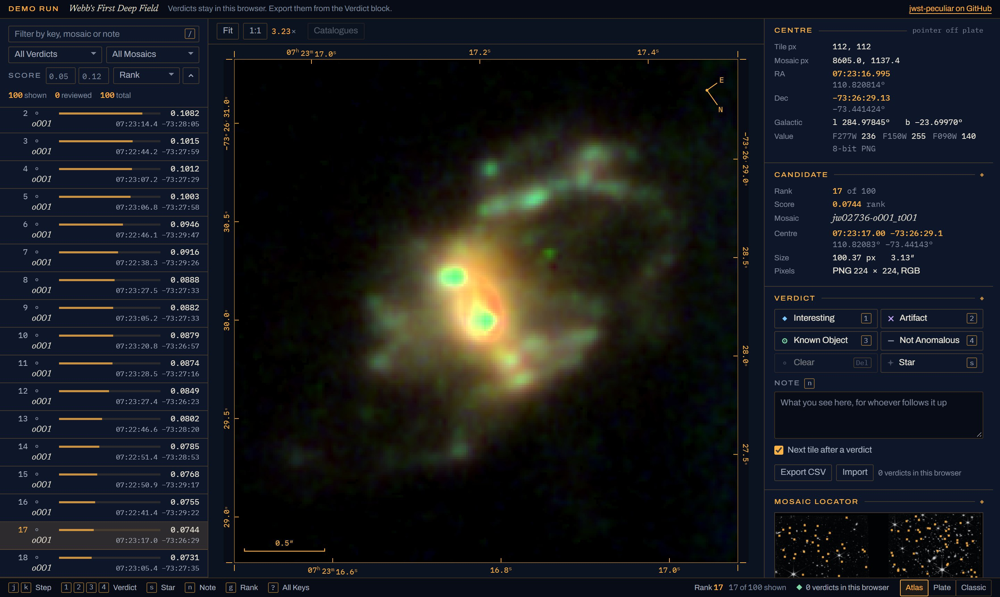

# jwst-peculiar

[](https://somethingobvious.github.io/jwst-peculiar/)

jwst-peculiar looks for odd objects in JWST NIRCam mosaics, like mergers, rings, little red dots and the strange things nobody has a name for. It finds every source in a field, drops the ones that are instrument artefacts, embeds a colour stamp of each with Zoobot and ranks them by how unlike every other object they look. Verdicts you give in its viewer train a small classifier that pushes big ordinary galaxies down the list. Sources too small for a stamp get a second list, ranked on their colours. The [demo](https://somethingobvious.github.io/jwst-peculiar/) is its top 100 in Webb's First Deep Field.

On 148 COSMOS-Web fields (185,811 stamps) it took 2 hours 10 minutes on a laptop CPU to cut and 27 minutes on an RTX 4070 laptop GPU to embed, or about 6 hours on the CPU alone.

## How Well It Works

It was judged once on 21 COSMOS-Web observations it had never seen, against goals written down before the run, with the top 100 labelled blind by a single labeller with no second check. It had 57 worth a second look and no artefacts. It found 0.41 of the known odd objects in its top 1% of systems and 0.59 in its top 5%, short of the 0.70 goal, mostly as it finds mergers and rings well and lenses badly. The compact list found 235 of 330 known little red dots and brown dwarfs in its top 5% on development fields, but about half its top 100 on the held-out block were artefacts. [objects-plan.md](docs/objects-plan.md) has every goal and result.

## Install and Run

```
python -m venv .venv
.venv\Scripts\activate        # or source .venv/bin/activate
pip install -e .
```

It needs Python 3.11 or newer, and `pip install git+https://github.com/SomethingObvious/jwst-peculiar` installs it without a clone. On Windows pip installs the CPU build of PyTorch even when there is an NVIDIA GPU, so install the CUDA build from [pytorch.org](https://pytorch.org/get-started/locally/) first if you have one. `embed` ran 9 times faster on a laptop GPU than on its CPU. `jwst-peculiar objects check` says which device it will use.

A YAML file says where a survey's mosaics are.

```yaml
name: cosmos-web
out: runs/cosmos-web
pattern: mosaics/{field}_{band}_sci.fits
bands: [f115w, f150w, f277w, f444w]
```

```
jwst-peculiar objects cut survey.yaml
jwst-peculiar objects embed survey.yaml
jwst-peculiar objects rank survey.yaml
jwst-peculiar objects view survey.yaml
jwst-peculiar objects label survey.yaml
jwst-peculiar objects compact survey.yaml
```

[Usage](docs/usage.md#objects) covers each step and how to label well.

## Try It on Public Data

[examples/smacs0723.yaml](examples/smacs0723.yaml) runs it on Webb's First Deep Field, which is what the demo shows. The four mosaics are 4.2 GB from MAST, and `curl` comes with Windows 10 and later, macOS and Linux.

```
cd examples
mkdir mosaics
curl -L -o mosaics/jw02736-o001_t001_nircam_clear-f090w_i2d.fits "https://mast.stsci.edu/api/v0.1/Download/file?uri=mast:JWST/product/jw02736-o001_t001_nircam_clear-f090w_i2d.fits"
curl -L -o mosaics/jw02736-o001_t001_nircam_clear-f150w_i2d.fits "https://mast.stsci.edu/api/v0.1/Download/file?uri=mast:JWST/product/jw02736-o001_t001_nircam_clear-f150w_i2d.fits"
curl -L -o mosaics/jw02736-o001_t001_nircam_clear-f277w_i2d.fits "https://mast.stsci.edu/api/v0.1/Download/file?uri=mast:JWST/product/jw02736-o001_t001_nircam_clear-f277w_i2d.fits"
curl -L -o mosaics/jw02736-o001_t001_nircam_clear-f444w_i2d.fits "https://mast.stsci.edu/api/v0.1/Download/file?uri=mast:JWST/product/jw02736-o001_t001_nircam_clear-f444w_i2d.fits"
jwst-peculiar objects check smacs0723.yaml
jwst-peculiar objects cut smacs0723.yaml
jwst-peculiar objects embed smacs0723.yaml
jwst-peculiar objects rank smacs0723.yaml -n 100
jwst-peculiar objects view smacs0723.yaml
```

On a laptop `cut` took a minute and 3.7 GB of memory, and `embed` took 22 seconds on its GPU or 3.5 minutes on its CPU, after downloading the Zoobot weights the first time. `view` opens the list in your browser.

## What It Won't Do

A stamp needs S/N over 40 and a semimajor axis over 0.12", so anything smaller only reaches the compact list, which needs all four bands. Rarity is relative to the fields you give it, so whatever is common there counts as ordinary, though `rank --reference` can add a bigger survey's objects to compare against. Nothing it lists is a discovery until someone has looked at the data.

## The Patch Search

The older search still works on any FITS image with a WCS, HST and Euclid included. It scores tiles by how far their DINOv3 patches sit from ordinary sky, which can catch diffuse light that source detection misses. [Usage](docs/usage.md#the-patch-search) and [the method](docs/method.md) cover it.

## Tests

```
pip install -e .[dev]
pytest
cd web && npm ci && npm test
```

## Licence

It's under the [PolyForm Noncommercial License 1.0.0](LICENSE.md). You can use it, change it and share it for anything noncommercial like research or study. Commercial use isn't allowed.
